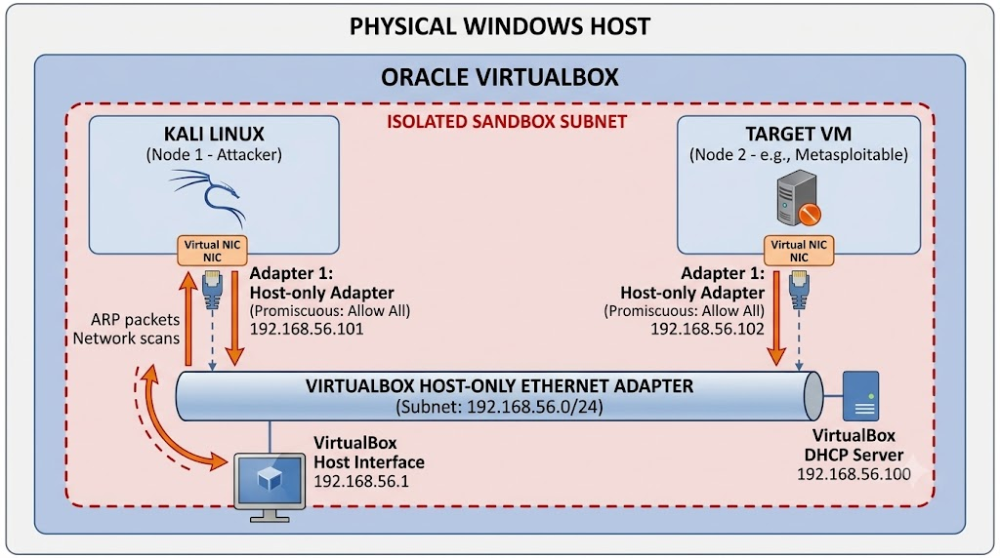
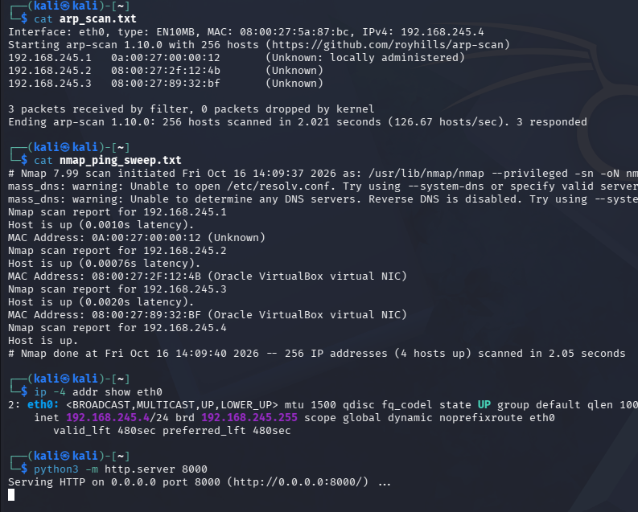

# Local Network Topology & Active Host Discovery Mapping

## 1. Executive Summary & Sandboxed Lab Scope
This project establishes a sandboxed virtual reconnaissance lab built on an isolated Layer 2 subnet using Oracle VirtualBox Host-Only networking. Active Layer 2 (ARP) and Layer 3 (ICMP Ping Sweep) host discovery techniques were executed from Kali Linux to map all live nodes, extract hardware addresses, identify NIC vendors, and model the local network topology without performing invasive port scans.

### Network Boundaries
- **Operating Interface:** `eth0`
- **Assigned Subnet (CIDR):** `192.168.245.0/24`
- **Default Gateway / Host Adapter:** `192.168.245.1`
- **Subnet Broadcast Boundary:** `192.168.245.255`
- **Subnet Mask:** `255.255.255.0`

---

## 2. Active Host Inventory & Allocation Table

| IP Address | MAC Address | NIC Vendor (OUI) | Host Role / Operating System |
| :--- | :--- | :--- | :--- |
| `192.168.245.1` | `0a:00:27:00:00:12` | Locally Administered (VirtualBox) | Host Virtual Interface Gateway |
| `192.168.245.2` | `08:00:27:2f:12:4b` | PCS Systemtechnik / Oracle VirtualBox | VirtualBox DHCP Service Engine |
| `192.168.245.3` | `08:00:27:89:32:bf` | PCS Systemtechnik / Oracle VirtualBox | Metasploitable2 (Linux 2.6 Target Node) |
| `192.168.245.4` | `08:00:27:5a:87:bc` | PCS Systemtechnik / Oracle VirtualBox | Kali Linux 2026.2 (Scanning Node) |

---

## 3. Visual Network Architecture Diagram


---

## 4. Layer 2 Discovery: ARP Sweep
Layer 2 host discovery was executed using `arp-scan` to identify hosts via Address Resolution Protocol frames directly across the local broadcast domain.

```bash
sudo arp-scan -l | tee logs/arp_scan.txt
```

### Scan Output Summary
- **Targets Scanned:** 256 hosts
- **Packets Received:** 3
- **Identified Nodes:**
  - `192.168.245.1` (`0a:00:27:00:00:12`)
  - `192.168.245.2` (`08:00:27:2f:12:4b`)
  - `192.168.245.3` (`08:00:27:89:32:bf`)



---

## 5. Layer 3 Discovery: ICMP Ping Sweep
Layer 3 host discovery was performed using `nmap -sn` across the full `/24` prefix to isolate active IP addresses without initiating TCP/UDP transport-layer port sweeps.

```bash
nmap -sn 192.168.245.0/24 -oN logs/nmap_ping_sweep.txt
```

### Scan Output Summary
- **Total Addresses Scanned:** 256 IP addresses
- **Active Hosts Identified:** 4 hosts up
- **Local Scanner Node:** `192.168.245.4` (Kali Linux)
- **Log Verification:** Complete output archived in `logs/nmap_ping_sweep.txt`.

---

## 6. Repository Structure
```text
Week-01-Network-Topology-Mapping/
├── images/
│   └── network_topology.png
├── logs/
│   ├── arp_scan.txt
│   └── nmap_ping_sweep.txt
├── screenshots/
│   ├── terminal_discovery.png
│   └── terminal_discovery2.png
└── README.md
```