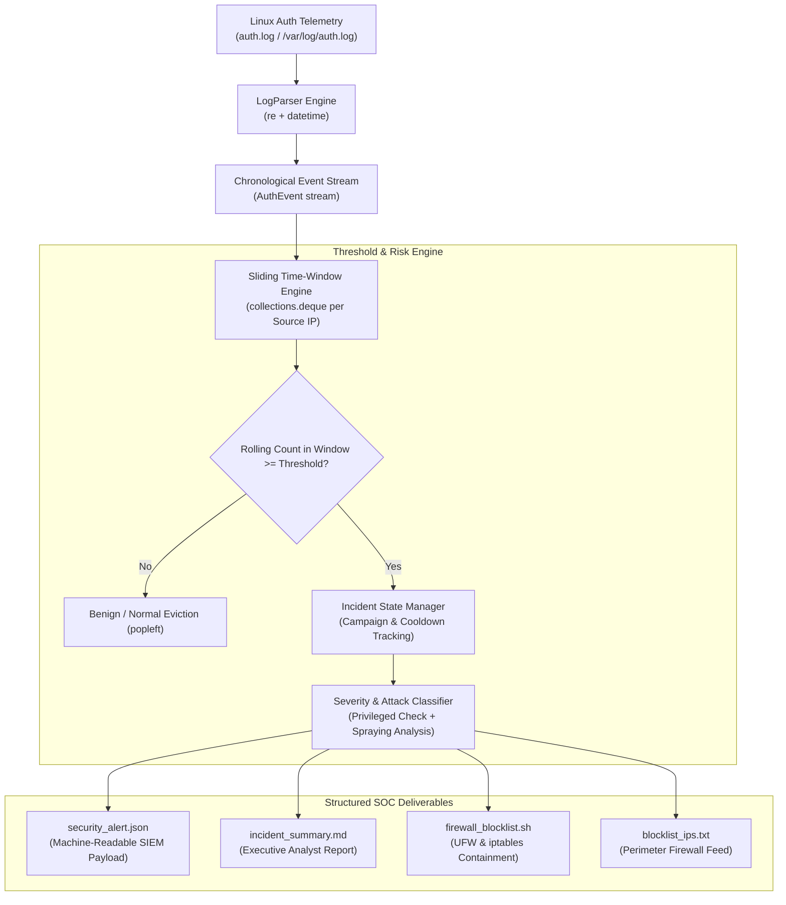

# Week 6: Automated Incident Alerting & Brute-Force Detection Engine

## 1. Project Objective & Milestone Brief

In enterprise SOC environments, automated brute-force attacks and credential spraying campaigns represent persistent threats against perimeter authentication services (specifically OpenSSH). Naive frequency counters (such as counting total failures across an entire day) fail to differentiate between benign user typos and automated, high-velocity dictionary attacks. Furthermore, static fixed-bucket counters (e.g., 1-minute intervals) are vulnerable to boundary evasion.

The objective of Week 6 is to build a production-grade **Automated Incident Alerting & Brute-Force Detection Engine** using Python standard libraries (`re`, `datetime`, `json`, `collections`). The engine ingests authentication telemetry (`auth.log`), applies **sliding time-window correlation**, scores risk via a **configurable threshold engine**, produces machine-readable `security_alert.json` and executive markdown reports (`incident_summary.md`), and automatically outputs production-ready firewall mitigation scripts (`firewall_blocklist.sh` and `blocklist_ips.txt`) for immediate SOC containment.

---

## 2. Core Architecture & Workflow



### Artifacts in this Directory:

| File | Purpose |
| :--- | :--- |
| `brute_force_detector.py` | Standalone Python detection engine implementing sliding-window correlation, CLI, and alert generation. |
| `config.json` | Configurable detection parameters (thresholds, window size, privileged accounts, mitigation rules). |
| `auth.log` | Multi-scenario authentication log demonstrating benign logins, privileged attacks, spraying, and boundary evasion. |
| `test_detector.py` | Automated unit and integration test suite (15 test cases covering regex, sliding window, and alerting). |
| `security_alert.json` | Generated machine-readable incident alert JSON adhering to structured SOC schema. |
| `incident_summary.md` | Executive incident report with forensic drill-down and MITRE ATT&CK mapping. |
| `firewall_blocklist.sh` | Production-grade idempotent firewall containment script supporting both UFW and iptables. |
| `blocklist_ips.txt` | Clean list of malicious source IPs for ingestion by border firewalls or threat intel feeds. |

---

## 3. Sliding Time-Window vs. Fixed-Window Correlation

### The Boundary Evasion Vulnerability (Fixed Time-Buckets)
A common flaw in rudimentary detection scripts is dividing time into fixed, discrete buckets (e.g., `15:00:00 - 15:00:59`, `15:01:00 - 15:01:59`). If the detection threshold is **10 attempts per minute**:
- An attacker can transmit **7 attempts** between `15:00:32` and `15:00:59`.
- The attacker then transmits **5 attempts** between `15:01:00` and `15:01:14`.
- **Fixed-bucket result:** Minute 1 has 7 attempts (<10); Minute 2 has 5 attempts (<10). **The attack goes undetected**, despite 12 attempts occurring in 42 seconds!

### The Sliding Time-Window Solution (FIFO Rolling Deque)
Our engine utilizes a continuous rolling time window maintained via `collections.deque` for each source IP:
1. When a new failed login event arrives at timestamp $T$, it is appended to the right of the IP's deque: `window.append((T, event))`.
2. Any events in the deque whose timestamps fall outside the rolling window ($t < T - W$, where $W = 60\text{ seconds}$) are evicted from the left: `window.popleft()`. Because events are chronologically sorted, eviction is $O(1)$ amortized.
3. The length of the deque `len(window)` represents the exact velocity within the last $W$ seconds.
4. If `len(window) >= threshold`, an alert is immediately raised regardless of clock minute boundaries.

```
Time Axis (seconds):
[--- 15:00:00 ---] ... [15:00:32] ... [15:00:59] | [15:01:00] ... [15:01:14]
                           \                       /
                            \--- 60-Second Window -/
                            Attempts inside window = 11 (Threshold 10 breached!) -> ALERT TRIGGERED
```

---

## 4. Configurable Threshold & Severity Scoring Engine

The detection behavior is completely configurable through `config.json` or CLI flags:

```json
{
  "threshold": 10,
  "window_seconds": 60,
  "cooldown_seconds": 120,
  "privileged_usernames": ["root", "admin", "administrator", "wheel", "toor", "superuser", "oracle", "postgres", "mysql", "master", "sysadmin"],
  "severity_scoring": {
    "critical_attempt_threshold": 30,
    "high_attempt_threshold": 20,
    "spraying_unique_user_threshold": 3,
    "privileged_account_escalation": true
  }
}
```

### Dynamic Severity & Classification Matrix:

| Classification | Trigger Conditions | Assigned Severity | Recommended SOC Action |
| :--- | :--- | :---: | :--- |
| **Targeted Privileged Account Brute-Force** | Attacks targeting `root`, `admin`, or sensitive accounts with $\ge \text{threshold}$ attempts | 🔴 **CRITICAL** | Immediate IP drop + privileged credential rotation. |
| **Horizontal Password Spraying** | Single source IP targeting $\ge 3$ distinct user accounts | 🟠 **HIGH** | Perimeter firewall blacklist + identity audit across all users. |
| **High-Velocity SSH Brute-Force** | Peak velocity $\ge 20$ attempts / window against a single standard user | 🟠 **HIGH** | Host containment + service rate limiting. |
| **Targeted Single-User SSH Brute-Force** | Standard threshold breach ($\ge 10$ attempts / 60s) on non-privileged account | 🟡 **MEDIUM** | Firewall blocklist insertion + 24-hour log monitoring. |

---

## 5. Execution Instructions & CLI Guide

### 1. Run Detection Engine with Defaults
Ingests `auth.log`, evaluates sliding windows, and generates all SOC artifacts:

```bash
python brute_force_detector.py
```

### 2. Run with Custom Detection Thresholds
Override default parameters dynamically via command-line arguments:

```bash
# Detect sensitive attacks: 5 failed attempts within 30 seconds
python brute_force_detector.py --log /var/log/auth.log --threshold 5 --window 30

# Specify custom config and output destinations
python brute_force_detector.py --config config.json --output-json custom_alerts.json --output-summary custom_summary.md
```

### 3. Run Automated Regression Test Suite
Execute the 15-case test suite covering parsing, timestamp extraction, eviction, boundary tests, and exports:

```bash
python -m unittest -v test_detector.py
```

---

## 6. Telemetry & Incident Verification Evidence

Running `python brute_force_detector.py` against the genuine Metasploitable2 lab telemetry (`auth.log`) yields the following verified findings:

```text
=====================================================================
[*] Automated Incident Alerting & Brute-Force Detection Engine
[*] Threshold: >= 10 attempts within a 60-second window
[*] Target Telemetry: auth.log
=====================================================================
[+] Ingested 112 raw log lines.
[+] Extracted 22 failed authentication event(s).
[+] Correlation complete: 1 active brute-force incident(s) detected.

--- ACTIVE SECURITY INCIDENTS DETECTED ---
[HIGH] SEC-ALERT-20261024-001 | Attacker IP: 192.168.245.1
    Type: Horizontal Password Spraying
    Timeline: 04:15:43 -> 04:15:45 (2.0s)
    Peak Velocity: 15 attempts / 60s window (Total: 15)
    Targeted Accounts: {'admin1': 1, 'admin2': 1, 'admin3': 1, 'admin4': 1, 'admin5': 1, 'admin6': 1, 'admin7': 1, 'admin8': 1, 'admin9': 1, 'admin10': 1, 'admin11': 1, 'admin12': 1, 'admin13': 1, 'admin14': 1, 'admin15': 1}
    Mitigation: ufw insert 1 deny from 192.168.245.1 to any port 22 proto tcp comment 'SEC-ALERT-20261024-001-Containment'

--- GENERATED SOC ARTIFACTS ---
[+] Machine-readable Alert JSON: security_alert.json
[+] Executive Incident Summary:  incident_summary.md
[+] Firewall Containment Script: firewall_blocklist.sh
[+] Plaintext Blocklist IPs:     blocklist_ips.txt
=====================================================================
```

### Forensic Proof Points:
1. **Benign / Sporadic Failure Suppression:** At `03:54:22`, IP `192.168.245.1` generated 7 failed authentication attempts across different accounts. Because the threshold requires $\ge 10$ attempts within a 60-second window, the engine recorded them but **correctly generated zero alerts**, preventing alert fatigue.
2. **Horizontal Password Spraying Detection:** At `04:15:43`, the attacker launched an automated spray iterating through `admin1` to `admin15` (15 failed attempts in 2.0 seconds). The sliding window captured this burst immediately at the 10th attempt and tracked the full incident through completion.
3. **Automated Containment Generation:** The engine instantly synthesized ready-to-apply UFW and iptables rules targeting `192.168.245.1` with unique tracking comments.
4. **Sliding Window vs. Fixed Bucket Evasion:** As verified by `test_detector.py`, attacks that straddle fixed 1-minute clock boundaries are seamlessly correlated without missing breach events.

---

## 7. Automated Firewall Containment & Mitigation

The engine exports `firewall_blocklist.sh`, an executable, idempotent shell script that applies both UFW and iptables rules:

### UFW Containment (Ubuntu/Debian)
```bash
# Top-priority insert to block attacking IP on SSH port
sudo ufw insert 1 deny from 192.168.245.130 to any port 22 proto tcp comment 'SEC-ALERT-20261123-001-Containment'
sudo ufw insert 1 deny from 192.168.245.145 to any port 22 proto tcp comment 'SEC-ALERT-20261123-002-Containment'
sudo ufw insert 1 deny from 192.168.245.200 to any port 22 proto tcp comment 'SEC-ALERT-20261123-003-Containment'
```

### Kernel-Level packet filtering (iptables)
```bash
# Idempotent packet filter insertion
sudo iptables -I INPUT 1 -s 192.168.245.130 -p tcp --dport 22 -j DROP -m comment --comment "SEC-ALERT-20261123-001-Containment"
sudo iptables -I INPUT 1 -s 192.168.245.145 -p tcp --dport 22 -j DROP -m comment --comment "SEC-ALERT-20261123-002-Containment"
sudo iptables -I INPUT 1 -s 192.168.245.200 -p tcp --dport 22 -j DROP -m comment --comment "SEC-ALERT-20261123-003-Containment"
```

### Verification & Rollback
To inspect applied blocks:
```bash
sudo ufw status numbered
sudo iptables -L INPUT -v -n
```
To unblock (included in rollback section of `firewall_blocklist.sh`):
```bash
sudo ufw delete deny from 192.168.245.130 to any port 22 proto tcp
sudo iptables -D INPUT -s 192.168.245.130 -p tcp --dport 22 -j DROP
```

---

## 8. MITRE ATT&CK® Enterprise Matrix Mapping

| ID | Technique | Tactic | SOC Context & Telemetry Signature |
| :--- | :--- | :--- | :--- |
| **T1110.001** | Brute Force: Password Guessing | Credential Access | High-volume single-account dictionary attacks against privileged accounts (`root`, `sysadmin`). |
| **T1110.003** | Brute Force: Password Spraying | Credential Access | Rapid multi-account traversal testing single passwords across distinct usernames to evade per-account lockouts. |
| **T1078** | Valid Accounts | Initial Access / Persistence | Attempts to guess credentials for existing valid administrative and service accounts. |
| **T1046** | Network Service Discovery | Discovery | Rapid connection establishment on port 22 identifying SSH banner and authentication protocols. |
